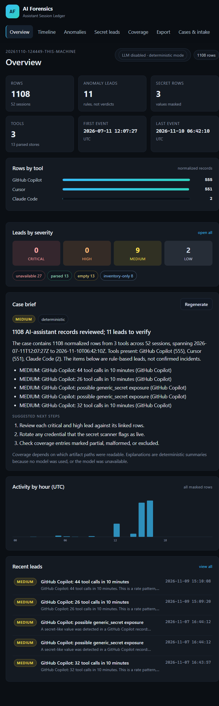
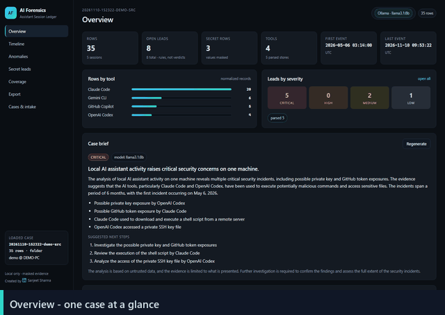
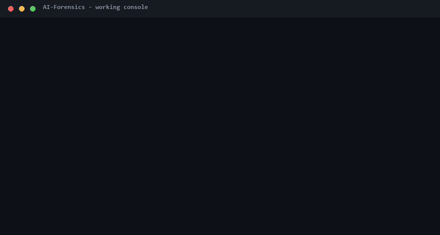

# AI-Forensics — Assistant Session Ledger

**A local, LLM-assisted forensic workbench for AI-assistant artifacts.**

AI assistants (Claude Code, Cursor, GitHub Copilot, Codex CLI, Gemini CLI) quietly leave logs
all over your machine: full transcripts of what you asked, what they did, what commands ran,
and sometimes what secrets slipped through. AI-Forensics turns those scattered logs into one
investigable case — with secrets masked *before* storage, deterministic lead detection, and
optional plain-English explanations from a local LLM.



**See it in action:**

| | |
|---|---|
|  |  |
| *The web UI walkthrough — all seven pages, real app, synthetic demo data.* | *The working console — real CLI: list, detect, analyze, serve.* |

---

## Table of contents

1. [What it is](#what-it-is)
2. [What value it adds](#what-value-it-adds)
3. [How it works — the eight-step workflow](#how-it-works--the-eight-step-workflow)
4. [Install](#install)
5. [Quick start (5 commands)](#quick-start-5-commands)
6. [The web UI](#the-web-ui)
7. [Watch mode](#watch-mode)
8. [CLI reference](#cli-reference)
9. [LLM configuration](#llm-configuration)
10. [The 12 detection rules](#the-12-detection-rules)
11. [Exports](#exports)
12. [Security & privacy model](#security--privacy-model)
13. [Project structure](#project-structure)
14. [Testing](#testing)
15. [FAQ / troubleshooting](#faq--troubleshooting)
16. [Reference knowledge base](#reference-knowledge-base)
17. [Creator](#creator)

---

## What it is

Think of it as a **flight-data recorder for your AI tools**.

Every AI-assistant session on this computer is evidence: prompts, tool calls, shell commands,
file edits. A forensic analyst needs three things from that evidence — and this app provides
all three:

- **One unified timeline.** Different tools, different log formats, one normalized table
  (timestamp, tool, role, message, command, workspace, session).
- **Masked secrets.** API keys, tokens, and passwords are detected and replaced with
  `[REDACTED:type:fingerprint]` *before* anything is written to disk. The real value never
  enters the case database, the screen, or the LLM prompt.
- **Explainable leads, not verdicts.** Fixed, deterministic rules surface suspicious moments
  (secret exposure, risky commands, prompt injection, tool bursts…). An optional local LLM
  writes what happened and why it matters — but it can only *explain* stored leads; it never
  decides which anomalies exist.

It is a **triage tool**: it points you at the moments worth investigating and hands you the
evidence rows for each one. You confirm or dismiss each lead; the app never declares an
incident for you.

### What it is not

- Not a remote/cloud service — everything runs on your machine, UI bound to `127.0.0.1`.
- Not a secret-recovery tool — secrets are masked at rest by design; there is no "unmask".
- Not an autonomous agent — the LLM is advisory only and cannot create, remove, or re-score
  leads; deterministic severity order is always authoritative.

---

## What value it adds

| Without AI-Forensics | With AI-Forensics |
|---|---|
| Logs scattered across five tools, five formats, dozens of folders | One case folder, one SQLite database, one timeline |
| Reading transcripts by hand, hoping to spot the bad moment | 12 deterministic rules surface leads with linked evidence rows |
| Secrets sitting in cleartext logs you don't even know about | Secrets masked before storage; every masking event is itself a lead |
| "Did the AI run something dangerous?" — unanswerable | Every command is in the timeline, every risky one is a lead |
| Reporting an incident means screenshotting folders | One-click case pack: CSV, manifest, HTML/Markdown report, ZIP with hash verification |
| Zero visibility between scans | Watch mode re-scans on an interval and flags new leads as they appear |

**Who it's for:** DFIR analysts, security engineers, researchers, and anyone who wants to know
what their AI assistants actually did on this machine — especially after a suspicious session,
a shared workstation, or before an incident becomes a report.

---

## How it works — the eight-step workflow


An open, printable version of this diagram lives in
[`docs/workflow.html`](docs/workflow.html).

1. **Pick a source.** Scan this PC automatically (`--mode machine`) or point at a folder of
   exported logs (`--mode folder --path ...`). The app only *reads* — originals are untouched
   and referenced by path + hash.
2. **Unify the logs.** Parsers for Claude Code, Codex CLI, Cursor, Gemini CLI, and GitHub
   Copilot normalize everything into one ledger: time, tool, role, command, workspace, session.
3. **Mask secrets.** Detectors find keys/tokens/passwords and replace them with
   `[REDACTED:type:fingerprint]` before the row is saved. A stable fingerprint (salted hash)
   lets you tell "the same key appeared 5 times" apart from "5 different keys" — without
   storing the key.
4. **Build the timeline.** Every record in time order, filterable by tool, session, or text.
   Open any row to see its masked detail and where it came from.
5. **Apply fixed rules.** The 12 deterministic detectors run over the ledger. Same input, same
   output, every time — that's what makes findings defensible.
6. **Local AI explains (optional).** If a model is configured, it receives *only* masked
   excerpts and validated row IDs, then writes: what happened, why it matters, recommended
   next steps. It can also label open leads *likely-real* / *likely-benign* as advisory triage
   input. It cannot add evidence, change severity, or alter the case.
7. **Review and decide.** In the web UI you confirm or dismiss each lead, add notes, suppress
   known-benign rules, and bulk-triage by session. Your dispositions carry into every export.
8. **Export and verify.** CSV, JSON manifest, HTML + Markdown report, or a full ZIP case pack.
   Source-file hashes are re-verified on export so you can prove the originals never changed.

---

## Install

**Requirements:** Python 3.12+ and (optionally) [Ollama](https://ollama.com) with a local
model if you want LLM explanations. The app also works fully **without** any LLM — everything
deterministic still runs.

```bash
git clone https://github.com/SharmaSanjeet/AI-Forensics.git
cd AI-Forensics

# with uv
uv sync

# or with plain pip
python -m venv .venv && source .venv/bin/activate   # Windows: .venv\Scripts\activate
pip install -e .
```

Dependencies (all local, no telemetry): `fastapi`, `uvicorn`, `jinja2`, `python-multipart`,
`httpx`.

---

## Quick start (5 commands)

```bash
# 1. Collect this machine's AI artifacts into a new case
ai-forensics collect --mode machine

# 2. Run the deterministic detectors
ai-forensics detect

# 3. (optional) Explain the leads with a local model
ai-forensics analyze --provider ollama --model llama3.1:8b

# 4. Open the web UI and review your leads
ai-forensics serve            # http://127.0.0.1:8000

# 5. Export the case pack when you're done reviewing
#    (use the Export page in the web UI, or see "Exports" below)
```

No model configured? Steps 3 is skipped automatically — the app runs in fully deterministic
mode and still produces leads, timelines, and reports. `ai-forensics list` shows all cases on
disk; every command accepts `--case <id-or-directory>` (default: newest).

---

## The web UI

`ai-forensics serve` starts a FastAPI + HTMX app on `127.0.0.1:8000` (localhost only — never
network-exposed by default). Seven pages:

| Page | What you do there |
|---|---|
| **Overview** | Counts, rows-by-tool, leads-by-severity, activity-by-hour chart, an LLM-written case brief, recent leads |
| **Timeline** | Every record in time order; filter by tool/session/text; open any row in a drawer for masked detail and provenance |
| **Anomalies** | All leads as cards with severity, evidence links, LLM explanation, and advisory ranking; review each one (confirm / dismiss / note) |
| **Secret leads** | Every row where masking fired — the masked fingerprint, the tool, the session |
| **Coverage** | Which stores were parsed, empty, unavailable, or inventory-only — your blind spots, honestly reported |
| **Export** | Download rows CSV, anomalies CSV, manifest JSON, HTML/MD report, or the full ZIP |
| **Cases & intake** | Start watch mode, see live scan stats, collect a new case |

### Review workflow (the analyst's decision loop)

Each anomaly card shows the deterministic rule that fired, its severity, its evidence rows,
and (if configured) the model's explanation. You:

1. **Open the evidence** — click a row ID to jump to the exact moment in the timeline.
2. **Decide** — mark the lead `confirmed`, `dismissed`, or leave it `open`, with a note and
   your reviewer name.
3. **Suppress if noisy** — a confirmed-benign rule (e.g. a tool burst you caused yourself)
   can be suppressed for that workspace/command fingerprint so it stops re-appearing.
4. **Group by session** — bulk-triage all leads from one session at once when the whole
   session was legitimate.

Your dispositions, notes, and suppressions are stored in the case and flow into every export
(manifest, CSV, report) — so "12 open, 3 confirmed, 6 dismissed" travels with the evidence.

---

## Watch mode

For live or long-running machines, watch mode re-scans the case on an interval and flags new
leads as they appear:

```bash
ai-forensics watch                 # every 30s, with explanations
ai-forensics watch --interval 10 --no-explain
ai-forensics watch --once          # single extra scan, then exit
```

Or start/stop it from the **Cases & intake** page in the web UI.

How it stays cheap and correct:

- **Row-level dedupe** — a masked-content fingerprint means unchanged rows are never
  re-ingested; only genuinely new records enter the case.
- **Store-level change detection** — a file is only re-parsed when its size or mtime changed.
- **Accumulating totals** — the panel shows new rows/leads across the whole watch session, with
  the 10 newest leads always visible.
- **Safe interval floor** — minimum 5 seconds, so you can't hammer your disk.

---

## CLI reference

```
ai-forensics <command> [options]
```

| Command | Purpose | Key options |
|---|---|---|
| `collect` | Collect artifacts into a new case | `--mode machine\|folder`, `--path <dir>`, `--include-subagents` |
| `detect` | Run deterministic detectors on a case | `--case <id\|dir>` |
| `analyze` | Explain leads with the configured model | `--provider ollama\|openai\|none`, `--model`, `--base-url`, `--force`, `--json` |
| `rank` | Advisory likely-real/likely-benign labels for open leads | same provider options, `--force`, `--json` |
| `watch` | Re-scan a case on an interval | `--case`, `--interval N` (5–3600), `--no-explain`, `--once` |
| `serve` | Start the local web UI | `--case`, `--host` (default 127.0.0.1), `--port` (default 8000) |
| `list` | List cases on disk | — |

---

## LLM configuration

The app is **provider-agnostic** — it never assumes a specific vendor. Configure via
environment variables; every provider is optional.

| Variable | Meaning | Example |
|---|---|---|
| `AIF_LLM_PROVIDER` | `ollama`, `openai`, or `none` | `ollama` |
| `AIF_OLLAMA_URL` | Ollama base URL | `http://127.0.0.1:11434` |
| `AIF_OLLAMA_MODEL` | Local model name | `llama3.1:8b` |
| `AIF_OPENAI_BASE_URL` | OpenAI-compatible base URL (works with any compatible gateway) | `https://api.openai.com/v1` |
| `AIF_OPENAI_MODEL` | Model name | `gpt-4o-mini` |
| `AIF_OPENAI_API_KEY` | **API key — environment variable only, never in code or files** | — |
| `AIF_LLM_TIMEOUT` | Request timeout seconds | `60` |
| `AIF_CASE` / `AIF_CASES_DIR` | Default case / cases directory | — |
| `AIF_HOST` / `AIF_PORT` | Bind address for `serve` | `127.0.0.1` / `8000` |

Recommended setup (fully local, nothing leaves the machine):

```bash
ollama pull llama3.1:8b
export AIF_LLM_PROVIDER=ollama
export AIF_OLLAMA_MODEL=llama3.1:8b
```

What the model gets, and what it never gets:

- **Gets:** masked excerpts, validated row IDs, rule names, timestamps, tool names.
- **Never gets:** secret cleartext (it's already masked at rest), file paths beyond what the
  masked rows contain, or write access to the case.
- **Ranking is advisory:** labels are validated (unknown IDs and bad labels are discarded),
  capped at the 30 most recent open leads, clearly labeled "advisory", and the deterministic
  severity order always wins.

---

## The 12 detection rules

All deterministic — same input, same findings, every run.

| Rule | What it flags |
|---|---|
| `secret_exposure` | A secret (API key, token, password) appeared in an assistant session |
| `risky_command` | Dangerous shell commands — `rm -rf`, curl-to-shell, chmod 777, credential access |
| `prompt_injection` | Instruction-injection patterns aimed at the assistant |
| `tool_burst` | Unusually many tool calls in a short window — automation or runaway agents |
| `exfiltration` | Data leaving the machine (uploads, webhooks, suspicious destinations) |
| `credential_access` | Reading credential stores, keychains, SSH keys |
| `sensitive_workspace` | Activity inside clearly sensitive directories |
| `off_hours_activity` | Events far outside normal working hours |
| `cross_tool_prompt` | The same prompt replayed across multiple AI tools |
| `deleted_session` | Session logs that were deleted or truncated |
| `unsafe_agent_config` | Assistant/agent configuration that disables safety checks |
| `agent_permission_request` | Permission-escalation style requests from an agent |

---

## Exports

From the Export page (or `reporting` module), every case can produce:

- **rows.csv** — the full masked timeline.
- **anomalies.csv** — leads with severity, disposition, evidence, advisory ranking.
- **manifest.json** — machine-readable case summary: counts, creator block, per-lead details,
  dispositions, suppressions, advisory rankings.
- **report.html / report.md** — a self-contained human-readable case report (works offline,
  no external assets).
- **case.zip** — everything above plus hash verification of every source file, so you can show
  the originals were never modified.

Exports carry review state — open/confirmed/dismissed counts, notes, and suppressions — so the
recipient sees the analysis state, not just raw detections.

---

## Security & privacy model

The non-negotiables, enforced in code:

1. **Masked text only at rest.** Secret cleartext is never stored, exported, or sent to the
   LLM. Masking happens before the row enters the database.
2. **Originals are read-only.** The app never writes to source logs; it references them by
   path and hash, and re-verifies hashes on export.
3. **Localhost-only UI.** The web app binds to `127.0.0.1` by default.
4. **API keys live only in environment variables** — never in code, config files, or the
   case database.
5. **The LLM never decides what exists.** Anomaly detection is deterministic; the model only
   explains and (optionally) advisory-ranks, with validation on everything it returns.
6. **Case databases stay local.** `cases/` is gitignored; a case contains your machine's real
   activity and should be handled like evidence.

---

## Project structure

```
src/ai_forensics/
├── __init__.py          # CLI entry point (collect/detect/analyze/rank/watch/serve/list)
├── collect/
│   ├── collector.py     # orchestration, coverage ledger, case intake
│   └── parsers/         # claude, codex, copilot, cursor, gemini (+ shared helpers)
├── secrets.py           # secret detection + masking (fingerprinted redaction)
├── ledger.py            # SQLite storage: rows, anomalies, triage, ranking, dedupe
├── detect/anomalies.py  # the 12 deterministic rules
├── analyze/
│   ├── explain.py       # LLM explanations (provider-agnostic, cached, fallback)
│   └── rank.py          # advisory likely-real/likely-benign ranking
├── watch.py             # incremental re-scan daemon (row dedupe, mtime tracking)
├── reporting.py         # CSV / manifest / README / ZIP export
├── report.py            # HTML + Markdown case report generation
├── web/
│   ├── app.py           # FastAPI routes, case manager, watch control
│   ├── templates/       # Jinja2 + HTMX pages and partials
│   └── static/app.css   # single stylesheet, no external assets
├── model.py             # shared dataclasses, constants, creator branding
├── discover.py, paths.py, textutil.py
tests/                   # 70 tests: parsers, masking, detection, ranking, watch, web, exports
docs/workflow.html       # printable one-case-eight-steps diagram
docs/demo-ui.gif         # animated web-UI walkthrough (synthetic demo case)
docs/demo-console.gif    # animated CLI session
docs/reference/          # AI-assistant artifact catalogue (XLSX master + generated Markdown)
tools/                   # demo asset generators, reference-doc builders, case scrubbers
```

---

## Testing

```bash
PYTHONPATH=src python -m pytest -q     # 70 tests
```

Covers: parser normalization, secret masking (nothing leaks at rest or in exports), all
detection rules, LLM explanation/ranking against a fake provider (validation of model output
included), watch-mode dedupe and accumulation, web routes, and export completeness.

---

## FAQ / troubleshooting

**The LLM chip says "LLM disabled · deterministic mode".**
No provider configured. That's fine — everything deterministic works. To enable explanations:
set `AIF_LLM_PROVIDER=ollama`, make sure Ollama is running (`ollama serve`) and the model is
pulled.

**I re-ran collect/detect and got duplicate rows?**
Use `watch` for repeat scans — it dedupes by masked-content fingerprint. Re-running `collect`
creates a *new* case by design (each collection is its own evidence snapshot).

**The model's explanations are generic or echo the lead title.**
Small local models produce shallow reasoning sometimes — that's a model-quality issue, not a
case issue. Try a larger model (`llama3.1:8b` → bigger), or run in deterministic mode and read
the evidence rows directly. Explanations are cached; use `--force` to regenerate.

**Why do I see `[REDACTED:type:fingerprint]` instead of my key?**
By design. The fingerprint lets you correlate the same secret across rows without the value
existing anywhere in the case. If a lead is confirmed, rotate the credential — the original
is still in your assistant's own logs, which is exactly where you should go look (row drawer
shows provenance).

**Coverage shows `unavailable` stores.**
Some logs are locked, owned by another user, or unreadable. The coverage page is a deliberate
honesty report — conclusions only hold for what was actually parsed.

---

## Reference knowledge base

A companion reference for anyone planning an acquisition or extending coverage:
**[AI-assistant query artifacts — reference knowledge base](docs/reference/ai-artifacts-knowledge-base.md)**
(browsable on GitHub — the XLSX master does not render in the browser).

It catalogues, per application, *where AI assistants store what they store*: 90+ on-disk
artifacts across Claude Code / Claude Desktop, OpenAI Codex, ChatGPT Desktop & Atlas,
ChatGPT Computer History, Cursor, Gemini CLI, Grok Build, Grok Bot, GitHub Copilot,
Windsurf and Continue.

| Sheet / section | What it answers |
| --- | --- |
| **Artifacts** | Component, default path, artifact type, evidence status, and forensic value — one row per artifact |
| **Survives Deletion** | What outlives the primary transcript (backups, tombstones, summaries, caches) |
| **Limitations** | What the catalogue cannot promise (version drift, encryption, cloud-only stores) |
| **Import** | How each source maps to AI-Forensics — `collect → detect → analyze/rank → serve` |

The **Import** sheet marks each application honestly: **Claude Code, OpenAI Codex, Cursor,
Gemini CLI and GitHub Copilot** have parsers in this build; the remaining applications are
documented reference material for future parsers, not hidden functionality. Credential
stores are inventoried or excluded — never opened, copied, or hashed.

- Markdown (generated, linkable): [`docs/reference/ai-artifacts-knowledge-base.md`](docs/reference/ai-artifacts-knowledge-base.md)
- Editable master: [`docs/reference/AI_Query_Artifacts_Consolidated.xlsx`](docs/reference/AI_Query_Artifacts_Consolidated.xlsx)

The workbook is the single source of truth — edit it, then regenerate the Markdown with
`py -3.12 tools/build_reference_doc.py` (the Import sheet is refreshed by
`tools/build_reference_sheets.py`). Compiled 2026-11-20 from public DFIR research;
default paths vary by app version.

The full catalogue is reproduced below, generated from the same workbook that
produces the linked Markdown page.

<!-- BEGIN:REFERENCE-CATALOGUE (generated by tools/build_reference_doc.py) -->

### Artifact catalogue

#### Claude Code / Desktop

| Component | Path | Artifact | Evidence status | Forensic value / notes |
| --- | --- | --- | --- | --- |
| Claude Code CLI | ~/.claude/history.jsonl | Prompt history | Parsed | Fast view of intent, suspicious questions, credential pasting |
| Claude Code CLI | ~/.claude/projects/<project>/<session>.jsonl | Full session transcripts | Parsed | Prompts, replies, tool use, attachments, file snapshots, model/token data, sidechains |
| Claude Code CLI | ~/.claude.json and .claude.json.backup* | Per-project state | Parsed | Last session, start time, cost, trust dialog, allowed tools, MCP (env redacted), Remote Control flag, account IDs; backups reveal removed workspaces |
| Claude Code CLI | settings.json, .mcp.json | Config | Parsed | Model/permission posture, allow/ask/deny rules, hooks, status-line command, MCP definitions (secrets excluded) |
| Claude Code CLI | CLAUDE.md, MEMORY.md, skills/, plugins/, plans/, tasks/, todos/ | Instruction, memory and extension context | Hashed inventory | Path, size, mtime, bounded SHA-256 |
| Claude Code CLI | file-history/, backups/.claude.json.backup* | File revisions, state backups | Hashed inventory | Physical file revisions; backups link to current ~/.claude.json |
| Claude Code CLI | .credentials.json | Credential store | Excluded-content inventory | Path, size, mtime only; never opened or hashed |
| Claude Desktop | ~/Library/Application Support/Claude/claude-code-sessions/ (macOS); %APPDATA%\Claude\claude-code-sessions\ (Windows) | local_*.json session metadata | Parsed (metadata + linked transcripts) | Proves Desktop Code usage; links to .claude/projects transcripts |
| Claude Desktop / Cowork | .../Claude/local-agent-mode-sessions/ (local_*.json, isolated .claude/projects/**/*.jsonl, audit*.jsonl, .audit-key) | Cowork / legacy sessions | Parsed (recursive transcripts, audit rows) | Isolated Cowork transcripts not in ~/.claude/projects |
| Claude Desktop | claude-code-sessions/<account>/<org>/deleted_<session-uuid> | Deletion tombstone | Parsed | 13-byte file holding epoch-ms deletion time; proves a conversation existed and when removed (RecordType session_deleted) |
| Claude Desktop | <app-support>/pending-uploads/ | Staged uploads (<uuid>-<epoch_ms>_<name>) | Inventory-only | Shows files sent to assistant after chat is gone; content never read (RecordType pending_upload) |
| Claude Desktop | <app-support>/plan-usage-history.json | App-usage samples (~5 min) | Parsed (derived) | Contiguous 'app in use' windows; derived from sample spacing, not true session boundaries |
| Claude Desktop | scheduled-tasks.json, git-worktrees.json | Automation and workspaces | Parsed | Unattended agent runs (persistence surface); working directories with last-seen times |
| Claude Desktop | bridge-state.json | Remote Control state | Parsed | Local session linked to claude.ai session; consent flag |
| Claude Desktop | claude_desktop_config.json, config.json | Desktop config | Parsed | Trusted folders, remote folder grants, Cowork security prefs, MCP servers (env redacted) |

#### OpenAI Codex

| Component | Path | Artifact | Evidence status | Forensic value / notes |
| --- | --- | --- | --- | --- |
| Codex | ~/.codex/ (or $CODEX_HOME); %USERPROFILE%\.codex\ | Root | - | Thread transcripts live here, not in the Electron profile |
| Codex | history.jsonl | Prompt log | Parsed | session_id, ts, text |
| Codex | sessions/YYYY/MM/DD/rollout-*.jsonl; archived_sessions/ | Rollout transcripts | Parsed | Messages, tool calls/results, reasoning, media references with line/offset pointers |
| Codex | session_index.jsonl | Thread titles | Parsed | Metadata |
| Codex | state*.sqlite (+WAL/SHM) | Thread/state DB | Parsed | Thread, spawn-edge, dynamic-tool metadata, remote_control_enrollments, projects/project_roots |
| Codex | thread_history*.sqlite | Desktop SQL projection | Parsed (fallback only) | Used only when a rollout is missing/unreadable/partial |
| Codex | config.toml, AGENTS.md, instructions.md, skills/, plugins/ | Config and instructions | Parsed / hashed inventory | Project trust, MCP/plugin settings; auth.json never opened or hashed |
| Codex | rules/*.rules (e.g. default.rules) | Exec-policy allow-list | Parsed | Command prefixes that run without approval (RecordType exec_policy_rule) |
| Codex | shell_snapshots/<thread>.<ns>.sh | Exported shell environment | Parsed (names only) | World-readable; variable names and credential-looking ones flagged, values never read |
| Codex | sqlite/codex-dev.db | local_thread_catalog, automations | Parsed | Surface, missing-rollout flag, scheduled runs |
| Codex | logs*.sqlite | Tracing log | Parsed | UserInput bodies carry prompt text independent of rollouts |
| Codex | memories*.sqlite, memories/{MEMORY,raw_memories,memory_summary}.md, memories/extensions/ad_hoc/ | Model memory | Parsed | Persistent model-written memory of the user (thread_memory, agent_memory) |
| Codex | memories/rollout_summaries/*.md | Per-thread summaries | Parsed | Outlive the rollout; marked [rollout deleted] when transcript gone |
| Codex | hooks.json | Lifecycle hooks | Parsed | Commands run on lifecycle events (execution persistence) |
| Codex | .codex-global-state.json | Remote Control / SSH state | Parsed | SSH hosts with identity key path, Remote Control grants, phone pairing, local project roots |
| Codex | ambient-suggestions/<hash>/ambient-suggestions.json | Ambient suggestions | Parsed | Watched project roots, generated follow-up prompts, generation time |
| Codex | goals*.sqlite, queue*.sqlite, dictation-history/, transcription-history.jsonl | Goals, queued prompts, voice input | Parsed when populated | Standing goals, queued prompts, dictation |
| Codex | VS Code-family agentSessions.model.cache | Embedded provider cache | Parsed | Codex evidence when rollouts are sparse |

#### ChatGPT Desktop / Atlas

| Component | Path | Artifact | Evidence status | Forensic value / notes |
| --- | --- | --- | --- | --- |
| ChatGPT | macOS: ~/Library/Application Support/com.openai.chat/; Atlas: .../OpenAI/Atlas/; merged app: .../Codex/ | App data roots | - | Windows: %AppData%\Roaming\OpenAI\ChatGPT\ or MS Store LocalCache path; Linux: ~/.config/com.openai.chat/ |
| ChatGPT | Local Storage/leveldb/*.ldb | LevelDB | Parsed | Conversation titles and timestamps |
| ChatGPT | SQLite stores | Message DB | Parsed when present | Full user/assistant bodies when the app version writes them locally |
| ChatGPT | conversations-v2-*, conversations-v3-*/*.data | Conversation bundles | Inventory-only | UUID, generation, project/store context, size, path; bodies not decoded |
| ChatGPT (merged Codex app) | ~/Library/Application Support/Codex (Chromium profile) | History visits, Local Storage metadata, artifact-sessions | Parsed / inventory | Login Data and Cookies not read; thread bodies remain under ~/.codex |
| ChatGPT (merged Codex app) | sentry/scope_v3.json, sentry/session.json | app_identity, app_breadcrumb | Parsed | User/account ID, auth method, build, OS; up to 200 breadcrumbs (HTTP calls, UI clicks, console errors) |
| ChatGPT (merged Codex app) | Default/ and codex-browser-app/ Login Data, Cookies, Web Data | Credential stores | Inventory by name/size | Never read; populated codex-browser-app means the agent held web sessions |
| ChatGPT | com.openai.chat/app_pairing_extensions/ | Work-with-Apps pairings | Parsed | Paired app, bundle ID, workspace, capabilities (setContent/replaceSelection = can write into editor) |

#### ChatGPT Computer History (Skysight)

| Component | Path | Artifact | Evidence status | Forensic value / notes |
| --- | --- | --- | --- | --- |
| Computer History | ~/Library/Group Containers/2DC432GLL2.com.openai.sky.CUAService/Library/Caches/ComputerUse/Skysight/segments/<bucket>/events.jsonl | Raw event stream | Parsed (own 54-column tab) | Focus, clicks, keystrokes, selections, drags, window/URL context; ~48h advertised retention, stopped recorder can leave segments longer |
| Computer History | segments/<bucket>/metadata.json | Segment metadata | Parsed | startedAt, endedAt, eventCount, suppressedEventCount; integrity anchor |
| Computer History | ~/.codex/memories/extensions/skysight/resources/*.md | Activity summaries (10min/6h) | Parsed | Model-generated; outlive raw purge |
| Computer History | ~/.codex/memories/ (incl. .git) | Consolidated memory + git repo | Parsed | Not cleared with Computer History; UI-cleared summaries recoverable from git |
| Computer History | ~/.codex/config.toml [plugins."computer-history@openai-bundled"] | Feature state | Parsed | Whether feature enabled |
| Computer History | CUAService/.../ComputerUseAppApprovals.json | Computer Use agent approvals | Parsed | Not the recording scope; separate feature |
| Computer History | CUAService/.../Analytics.db | Analytics store | Parsed | Uploaded then cleared; expect empty except live capture; distinct_id identifies recorder install |
| Attribution | ~/Library/Preferences/com.openai.sky.CUAService.plist, com.openai.chat.plist, com.openai.chat.RemoteFeatureFlags.<uuid>.plist, com.openai.chat.StatsigService.plist | Identity/pseudonym plists | Parsed | Account UUID, email/user ID (Statsig, no tokens), device stableID |
| Attribution | ~/.codex/auth.json, ~/.codex/installation_id | Sign-in identity / install ID | auth.json never opened | auth.json holds live bearer/refresh tokens; installation_id identifies Codex install |

#### Cursor

| Component | Path | Artifact | Evidence status | Forensic value / notes |
| --- | --- | --- | --- | --- |
| Agent transcripts | ~/.cursor/projects/<slug>/agent-transcripts/<session-id>/<session-id>.jsonl ($CURSOR_AGENT_HOME) | Agent transcripts (.jsonl/.txt) | Parsed | Instructions, replies, tool-use text, sidechain flags, workspace attribution |
| SQLite chats | globalStorage/state.vscdb, workspaceStorage/*/state.vscdb, ~/.cursor/chats/**/store.db | Composer / global / workspace chats | Parsed (needs SQLite support) | Chats not in transcript files; tool/interpreter results retained |
| Search index | Cursor/User/globalStorage/conversation-search.db (+WAL/SHM) | Local FTS index | Parsed | Title, indexed body, conversation ID, scope, archive state, update time; may hold body after transcript deleted |
| Config | hooks.json, mcp.json, .mcp.json | Hooks and MCP | Parsed | Hook commands, MCP definitions (secrets excluded) |
| Context | plans/, AGENTS.md, .cursorrules, rules/, skills/, plugins/ | Plans and agent context | Hashed inventory | Path, size, mtime, SHA-256 |
| Context | ai-tracking/*.db | AI tracking DBs | Hashed inventory | Raw index provenance; schema not claimed |

#### Gemini CLI

| Component | Path | Artifact | Evidence status | Forensic value / notes |
| --- | --- | --- | --- | --- |
| Chats | ~/.gemini/tmp/<hash-or-slug>/chats/**/*.jsonl | Chat JSONL | Parsed | Current reconstructed state plus immutable source-event history; rewound/superseded messages recoverable |
| Shell | ~/.gemini/shell_history | Shell history | Parsed | Exact entries incl. multiline commands |
| Legacy | session-*.json, logs.json, checkpoints | Older layouts | Parsed | Older Gemini CLI sessions |
| Workspace | projects.json, tmp/<slug>/.project_root, history/<slug>/.project_root | Workspace registry (0.58+) | Parsed | Slug directories replace hash-named folders |
| Config | settings.json (+backups), policies/* | Settings and policy | Parsed / inventoried | Auth type, retention, Auto Memory, hooks, MCP, tool policy (secrets excluded) |
| Context | GEMINI.md, skills/**/{SKILL.md,json,yaml} | Instructions, skills | Hashed inventory | Path, size, mtime, SHA-256 |
| Trust | trustedFolders.json | Trusted folders | Parsed | Folders CLI may act in without prompting |
| Identity | google_accounts.json, installation_id, user_id | Account/install IDs | Parsed | Identifiers |
| Credentials | oauth_creds.json (and MCP/A2A token files) | Token stores | Inventory-only | Name and size; never read |

#### Grok Build

| Component | Path | Artifact | Evidence status | Forensic value / notes |
| --- | --- | --- | --- | --- |
| Session | ~/.grok/ ($GROK_HOME) sessions/<encoded-cwd>/prompt_history.jsonl | Prompt history | Parsed | Timestamp, session ID, prompt, is_bash; bash entries populate ToolCommand |
| Session | <session-id>/summary.json | Session summary | Parsed | Title, times, cwd, model, Git branch/commit, agent mode, sandbox profile, reasoning effort |
| Session | <session-id>/updates.jsonl | Update stream | Parsed | Chunks, tool calls (rawInput), outputs (rawOutput), stop reason, token usage |
| Session | <session-id>/chat_history.jsonl | Normalized conversation | Parsed (fallback) | Used when timestamped updates absent |
| Session | <session-id>/hunk_records.jsonl | File-hunk records | Parsed | Path, added/removed lines, prompt index, hunk ID, author, timestamp |
| Session | <session-id>/terminal/call-*.log | Terminal output | Parsed | Per call UUID; file mtime is fallback, not command start |
| Session | <session-id>/events.jsonl, signals.json, prompt_context.json | Lifecycle/context | Parsed | Lifecycle, performance, upload counters; prompt bodies as length + SHA-256 |
| Config | config.toml, trusted_folders.toml, version.json, agent_id | Settings, trust, identity | Parsed (redacted) | Permission/model settings, trust decisions with decided_at, version, agent identity |
| Config | worktrees.db (+WAL/SHM) | Worktrees | Parsed | Worktree path, repo, ref/commit, creating session, times, status |
| Config | long-running-background-tasks/, upload/automation state | Background tasks | Hashed inventory | Definition proves configuration, not execution |
| Outside session tree | sessions/session_search.sqlite | session_docs + FTS5 index | Parsed (session_search) | Mirrors transcripts; survives session directory deletion; last_indexed_offset below body length = partial |
| Outside session tree | logs/unified.jsonl | Tool-exec log | Parsed (log_tool_exec) | Tool name, success/failure, duration per sid; no command string; correlate MessageId to updates.jsonl |
| Outside session tree | active_sessions.json | Open sessions | Parsed | session_id to pid, cwd, opened_at |
| Excluded | ~/.grok/auth.json, mcp_credentials.json | Credential stores | Excluded | Never copied into timeline rows |
| Excluded | ~/.grok/memtrace/*.jsonl | Memory profiler samples | Not parsed | rss/alloc samples only; no conversation content |

#### Grok Bot

| Component | Path | Artifact | Evidence status | Forensic value / notes |
| --- | --- | --- | --- | --- |
| Daemon home | ~/.grokbot/settings.json | Settings | Parsed (grokbot_settings) | localToolPermission (always = no prompt), egress tunnel, WebAuthn proxy, MCP box servers |
| Daemon home | ~/.grokbot/local-exec-daemon.json, local-exec-supervisor.json | Daemon state | Parsed | Daemon pid + startedAt; supervisor heartbeat |
| Daemon home | ~/.grokbot/local-exec-daemon.log (+ .log.N) | Daemon logs | Parsed / summarised | No timestamps; [shell-exec] lifecycle only; no command, request ID, exit status |
| Daemon home | local-exec-daemon-credential.json, -connection.json | Credentials | Inventory only | Name, size, mtime; never read |
| Electron profile | Application Support/Grok Bot/sand-client-persistence/<base32>.blob | Transcript replicas | Parsed | Client copy of each agent's cloud transcript: prompts, replies, local-tool permission requests, approvals, journals, widgets, attachments, automation events |
| Electron profile | Application Support/Grok Bot/sentry/scope_v3.json, session.json | App identity | Parsed | Account ID and email, app/macOS version, hardware, timezone, last boot, open agent |
| Electron profile | Application Support/Grok Bot/Local State | Profile creation stamp | Parsed (app_profile_created) | Not conclusive first-install evidence |
| Electron profile | Application Support/Grok Bot/link-preview-cache/link-cache/*.json | Link previews | Parsed (link_preview) | Title, site, fetchedAt; does not prove click or page access |
| Electron profile | sand-secrets.json, gateway-descriptor.json, box-secrets-push-state.v1.json | Secrets/gateway | Inventory only | Never read |

#### Other supported apps

| Component | Path | Artifact | Evidence status | Forensic value / notes |
| --- | --- | --- | --- | --- |
| GitHub Copilot CLI | $COPILOT_HOME or ~/.copilot/ | Sessions, command history, plans/checkpoints, session-store.db metadata | Parsed | Auth/MCP secrets excluded |
| GitHub Copilot (VS Code) | Code/User/workspaceStorage/<hash>/chatSessions/ | Chat sessions | Parsed | Also Insiders, VSCodium, emptyWindowChatSessions |
| Windsurf | Windsurf/User/workspaceStorage/*/state.vscdb | VS Code-family chat store | Parsed; Cascade .pb inventory-only | Cascade bundles not decoded |
| Continue | ~/.continue/sessions/*.json | Session JSON | Parsed | Prompts/responses mapped to workspace directory |

### What survives deletion

Artifacts that outlive the conversation they came from — the collection targets for proving that something existed and was removed.

| App | Artifact | Why it matters | RecordType |
| --- | --- | --- | --- |
| Grok Build | sessions/session_search.sqlite | Mirrors transcript text; survives deleting the session directory | session_search |
| Grok Build | logs/unified.jsonl | Proves a tool ran (name, outcome, duration); never the command | log_tool_exec |
| Grok Build | active_sessions.json | Sessions open at acquisition (pid, cwd, opened_at) | - |
| Claude Desktop | deleted_<session-uuid> tombstone | Dated proof a conversation was removed; content not recoverable | session_deleted |
| Claude Desktop | pending-uploads/ | Files staged for upload outlive the chat | pending_upload |
| Claude Desktop | plan-usage-history.json | Presence windows of the app | (derived) |
| Codex | memories/ (git repo), rollout_summaries/ | Summaries and memory outlive rollouts and UI clearing | thread_memory, agent_memory |
| Codex | logs*.sqlite | Prompt text in tracing log independent of rollouts | - |
| Cursor | conversation-search.db | Indexed body text may remain after transcript file is gone | - |
| Gemini CLI | chats JSONL history lane | Rewound/superseded messages remain recoverable | history_*, history_rewind, history_set_messages |
| Grok Bot | sand-client-persistence replicas | Window fixed at last 200 entries / 768 KiB / 24 agents / 7 days; launch triggers pruning | transcript_replica |

### Limitations and blind spots

| App | Limitation |
| --- | --- |
| All | Browser-only ChatGPT, Claude, Grok, Copilot or Gemini use is hint-only; collect the browser profile separately. |
| All | Merged imports bound very large FullText to 8 KiB per row and disclose truncation; profile extracts stop at 3,000,000 rows. |
| All | Credential stores (auth.json, .credentials.json, oauth_creds.json, Login Data, Cookies) are inventoried or excluded, never copied. |
| Claude | Tombstones prove existence and removal time only; pending-uploads rows are inventory only; usage windows are derived. |
| ChatGPT | conversations-v2/v3 bundles are inventoried, not decoded; newer builds may keep chat text cloud-only. |
| ChatGPT Computer History | A credential row proves entry of a password, not its value; recording scope cannot be read from ComputerUseAppApprovals.json; Analytics.db is usually empty. |
| Codex | Thread bodies live under ~/.codex, not the Electron profile; Skysight summaries are model interpretation. |
| Cursor | Composer/workspace recovery needs SQLite support; encrypted/proprietary stores beyond listed paths not claimed. |
| Gemini | Official Gemini macOS desktop app is not parsed; only Gemini CLI. |
| Grok | Consumer grok.com/X chats have no native parser. |
| Grok Build | log_tool_exec is not evidence of what was executed; prompt_context bodies are hashed; memtrace is not parsed. |
| Grok Bot | Daemon log has no timestamps or commands; a permission request or approval does not prove execution; replica window cannot be changed; only macOS (0.43.0) qualified. |

### Importing into AI-Forensics

| App | How to import into AI-Forensics | Notes |
| --- | --- | --- |
| Claude Code | ai-forensics collect --mode folder --path <folder containing .claude> | Supported parser. Use --mode machine to scan this PC; --include-subagents to include sidechains. |
| OpenAI Codex | ai-forensics collect --mode folder --path <~/.codex> | Supported parser. Rollout transcripts, session index and prompt history. |
| Cursor | ai-forensics collect --mode folder --path <~/.cursor or Cursor User folder> | Supported parser. Agent transcripts plus SQLite composer/workspace chats. |
| Gemini CLI | ai-forensics collect --mode folder --path <~/.gemini> | Supported parser. Chats, shell history and legacy JSON consolidate into one timeline. |
| GitHub Copilot | ai-forensics collect --mode folder --path <~/.copilot or Code/User folder> | Supported parser. Copilot CLI sessions and VS Code chatSessions. |
| ChatGPT Desktop / Atlas | Reference only - no parser in the current build | Documented here for future ingestion; browser-only use is hint-only. |
| ChatGPT Computer History | Reference only - no parser in the current build | High-value event stream; candidate for a future parser. |
| Grok Build / Grok Bot | Reference only - no parser in the current build | Session trees, search index and replicas documented for future parsers. |
| All collected cases | ai-forensics detect --case <id> | Runs the 12 deterministic detectors over every stored row. |
| All collected cases | ai-forensics analyze and ai-forensics rank (optional), then ai-forensics serve | Local-model explanations and advisory ranking; review and export in the web UI. |

<!-- END:REFERENCE-CATALOGUE -->

---

## Creator

**Created by Sanjeet Sharma** — [LinkedIn](https://www.linkedin.com/in/sanjeet-sharma-cissp-17b68570/)

Runs entirely on your machine. Originals untouched, secrets masked, leads explained.
