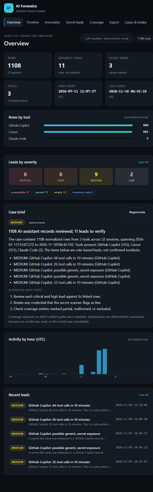
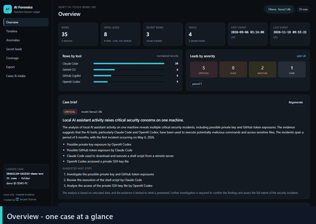
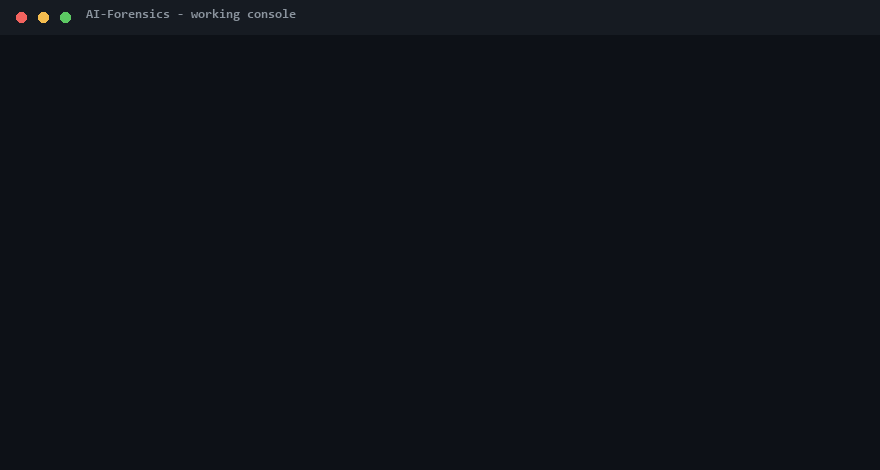

# AI-Forensics — Assistant Session Ledger

**A local, LLM-assisted forensic workbench for AI-assistant artifacts.**

AI assistants (Claude Code, Cursor, GitHub Copilot, Codex CLI, Gemini CLI) quietly leave logs
all over your machine: full transcripts of what you asked, what they did, what commands ran,
and sometimes what secrets slipped through. AI-Forensics turns those scattered logs into one
investigable case — with secrets masked *before* storage, deterministic lead detection, and
optional plain-English explanations from a local LLM.



**See it in action:**

| | |
|---|---|
|  |  |
| *The web UI walkthrough — all seven pages, real app, synthetic demo data.* | *The working console — real CLI: list, detect, analyze, serve.* |

---

## Table of contents

1. [What it is](#what-it-is)
2. [What value it adds](#what-value-it-adds)
3. [How it works — the eight-step workflow](#how-it-works--the-eight-step-workflow)
4. [Install](#install)
5. [Quick start (5 commands)](#quick-start-5-commands)
6. [The web UI](#the-web-ui)
7. [Watch mode](#watch-mode)
8. [CLI reference](#cli-reference)
9. [LLM configuration](#llm-configuration)
10. [The 12 detection rules](#the-12-detection-rules)
11. [Exports](#exports)
12. [Security & privacy model](#security--privacy-model)
13. [Project structure](#project-structure)
14. [Testing](#testing)
15. [FAQ / troubleshooting](#faq--troubleshooting)
16. [Creator](#creator)

---

## What it is

Think of it as a **flight-data recorder for your AI tools**.

Every AI-assistant session on this computer is evidence: prompts, tool calls, shell commands,
file edits. A forensic analyst needs three things from that evidence — and this app provides
all three:

- **One unified timeline.** Different tools, different log formats, one normalized table
  (timestamp, tool, role, message, command, workspace, session).
- **Masked secrets.** API keys, tokens, and passwords are detected and replaced with
  `[REDACTED:type:fingerprint]` *before* anything is written to disk. The real value never
  enters the case database, the screen, or the LLM prompt.
- **Explainable leads, not verdicts.** Fixed, deterministic rules surface suspicious moments
  (secret exposure, risky commands, prompt injection, tool bursts…). An optional local LLM
  writes what happened and why it matters — but it can only *explain* stored leads; it never
  decides which anomalies exist.

It is a **triage tool**: it points you at the moments worth investigating and hands you the
evidence rows for each one. You confirm or dismiss each lead; the app never declares an
incident for you.

### What it is not

- Not a remote/cloud service — everything runs on your machine, UI bound to `127.0.0.1`.
- Not a secret-recovery tool — secrets are masked at rest by design; there is no "unmask".
- Not an autonomous agent — the LLM is advisory only and cannot create, remove, or re-score
  leads; deterministic severity order is always authoritative.

---

## What value it adds

| Without AI-Forensics | With AI-Forensics |
|---|---|
| Logs scattered across five tools, five formats, dozens of folders | One case folder, one SQLite database, one timeline |
| Reading transcripts by hand, hoping to spot the bad moment | 12 deterministic rules surface leads with linked evidence rows |
| Secrets sitting in cleartext logs you don't even know about | Secrets masked before storage; every masking event is itself a lead |
| "Did the AI run something dangerous?" — unanswerable | Every command is in the timeline, every risky one is a lead |
| Reporting an incident means screenshotting folders | One-click case pack: CSV, manifest, HTML/Markdown report, ZIP with hash verification |
| Zero visibility between scans | Watch mode re-scans on an interval and flags new leads as they appear |

**Who it's for:** DFIR analysts, security engineers, researchers, and anyone who wants to know
what their AI assistants actually did on this machine — especially after a suspicious session,
a shared workstation, or before an incident becomes a report.

---

## How it works — the eight-step workflow


An open, printable version of this diagram lives in
[`docs/workflow.html`](docs/workflow.html).

1. **Pick a source.** Scan this PC automatically (`--mode machine`) or point at a folder of
   exported logs (`--mode folder --path ...`). The app only *reads* — originals are untouched
   and referenced by path + hash.
2. **Unify the logs.** Parsers for Claude Code, Codex CLI, Cursor, Gemini CLI, and GitHub
   Copilot normalize everything into one ledger: time, tool, role, command, workspace, session.
3. **Mask secrets.** Detectors find keys/tokens/passwords and replace them with
   `[REDACTED:type:fingerprint]` before the row is saved. A stable fingerprint (salted hash)
   lets you tell "the same key appeared 5 times" apart from "5 different keys" — without
   storing the key.
4. **Build the timeline.** Every record in time order, filterable by tool, session, or text.
   Open any row to see its masked detail and where it came from.
5. **Apply fixed rules.** The 12 deterministic detectors run over the ledger. Same input, same
   output, every time — that's what makes findings defensible.
6. **Local AI explains (optional).** If a model is configured, it receives *only* masked
   excerpts and validated row IDs, then writes: what happened, why it matters, recommended
   next steps. It can also label open leads *likely-real* / *likely-benign* as advisory triage
   input. It cannot add evidence, change severity, or alter the case.
7. **Review and decide.** In the web UI you confirm or dismiss each lead, add notes, suppress
   known-benign rules, and bulk-triage by session. Your dispositions carry into every export.
8. **Export and verify.** CSV, JSON manifest, HTML + Markdown report, or a full ZIP case pack.
   Source-file hashes are re-verified on export so you can prove the originals never changed.

---

## Install

**Requirements:** Python 3.12+ and (optionally) [Ollama](https://ollama.com) with a local
model if you want LLM explanations. The app also works fully **without** any LLM — everything
deterministic still runs.

```bash
git clone https://github.com/SharmaSanjeet/AI-Forensics.git
cd AI-Forensics

# with uv
uv sync

# or with plain pip
python -m venv .venv && source .venv/bin/activate   # Windows: .venv\Scripts\activate
pip install -e .
```

Dependencies (all local, no telemetry): `fastapi`, `uvicorn`, `jinja2`, `python-multipart`,
`httpx`.

---

## Quick start (5 commands)

```bash
# 1. Collect this machine's AI artifacts into a new case
ai-forensics collect --mode machine

# 2. Run the deterministic detectors
ai-forensics detect

# 3. (optional) Explain the leads with a local model
ai-forensics analyze --provider ollama --model llama3.1:8b

# 4. Open the web UI and review your leads
ai-forensics serve            # http://127.0.0.1:8000

# 5. Export the case pack when you're done reviewing
#    (use the Export page in the web UI, or see "Exports" below)
```

No model configured? Steps 3 is skipped automatically — the app runs in fully deterministic
mode and still produces leads, timelines, and reports. `ai-forensics list` shows all cases on
disk; every command accepts `--case <id-or-directory>` (default: newest).

---

## The web UI

`ai-forensics serve` starts a FastAPI + HTMX app on `127.0.0.1:8000` (localhost only — never
network-exposed by default). Seven pages:

| Page | What you do there |
|---|---|
| **Overview** | Counts, rows-by-tool, leads-by-severity, activity-by-hour chart, an LLM-written case brief, recent leads |
| **Timeline** | Every record in time order; filter by tool/session/text; open any row in a drawer for masked detail and provenance |
| **Anomalies** | All leads as cards with severity, evidence links, LLM explanation, and advisory ranking; review each one (confirm / dismiss / note) |
| **Secret leads** | Every row where masking fired — the masked fingerprint, the tool, the session |
| **Coverage** | Which stores were parsed, empty, unavailable, or inventory-only — your blind spots, honestly reported |
| **Export** | Download rows CSV, anomalies CSV, manifest JSON, HTML/MD report, or the full ZIP |
| **Cases & intake** | Start watch mode, see live scan stats, collect a new case |

### Review workflow (the analyst's decision loop)

Each anomaly card shows the deterministic rule that fired, its severity, its evidence rows,
and (if configured) the model's explanation. You:

1. **Open the evidence** — click a row ID to jump to the exact moment in the timeline.
2. **Decide** — mark the lead `confirmed`, `dismissed`, or leave it `open`, with a note and
   your reviewer name.
3. **Suppress if noisy** — a confirmed-benign rule (e.g. a tool burst you caused yourself)
   can be suppressed for that workspace/command fingerprint so it stops re-appearing.
4. **Group by session** — bulk-triage all leads from one session at once when the whole
   session was legitimate.

Your dispositions, notes, and suppressions are stored in the case and flow into every export
(manifest, CSV, report) — so "12 open, 3 confirmed, 6 dismissed" travels with the evidence.

---

## Watch mode

For live or long-running machines, watch mode re-scans the case on an interval and flags new
leads as they appear:

```bash
ai-forensics watch                 # every 30s, with explanations
ai-forensics watch --interval 10 --no-explain
ai-forensics watch --once          # single extra scan, then exit
```

Or start/stop it from the **Cases & intake** page in the web UI.

How it stays cheap and correct:

- **Row-level dedupe** — a masked-content fingerprint means unchanged rows are never
  re-ingested; only genuinely new records enter the case.
- **Store-level change detection** — a file is only re-parsed when its size or mtime changed.
- **Accumulating totals** — the panel shows new rows/leads across the whole watch session, with
  the 10 newest leads always visible.
- **Safe interval floor** — minimum 5 seconds, so you can't hammer your disk.

---

## CLI reference

```
ai-forensics <command> [options]
```

| Command | Purpose | Key options |
|---|---|---|
| `collect` | Collect artifacts into a new case | `--mode machine\|folder`, `--path <dir>`, `--include-subagents` |
| `detect` | Run deterministic detectors on a case | `--case <id\|dir>` |
| `analyze` | Explain leads with the configured model | `--provider ollama\|openai\|none`, `--model`, `--base-url`, `--force`, `--json` |
| `rank` | Advisory likely-real/likely-benign labels for open leads | same provider options, `--force`, `--json` |
| `watch` | Re-scan a case on an interval | `--case`, `--interval N` (5–3600), `--no-explain`, `--once` |
| `serve` | Start the local web UI | `--case`, `--host` (default 127.0.0.1), `--port` (default 8000) |
| `list` | List cases on disk | — |

---

## LLM configuration

The app is **provider-agnostic** — it never assumes a specific vendor. Configure via
environment variables; every provider is optional.

| Variable | Meaning | Example |
|---|---|---|
| `AIF_LLM_PROVIDER` | `ollama`, `openai`, or `none` | `ollama` |
| `AIF_OLLAMA_URL` | Ollama base URL | `http://127.0.0.1:11434` |
| `AIF_OLLAMA_MODEL` | Local model name | `llama3.1:8b` |
| `AIF_OPENAI_BASE_URL` | OpenAI-compatible base URL (works with any compatible gateway) | `https://api.openai.com/v1` |
| `AIF_OPENAI_MODEL` | Model name | `gpt-4o-mini` |
| `AIF_OPENAI_API_KEY` | **API key — environment variable only, never in code or files** | — |
| `AIF_LLM_TIMEOUT` | Request timeout seconds | `60` |
| `AIF_CASE` / `AIF_CASES_DIR` | Default case / cases directory | — |
| `AIF_HOST` / `AIF_PORT` | Bind address for `serve` | `127.0.0.1` / `8000` |

Recommended setup (fully local, nothing leaves the machine):

```bash
ollama pull llama3.1:8b
export AIF_LLM_PROVIDER=ollama
export AIF_OLLAMA_MODEL=llama3.1:8b
```

What the model gets, and what it never gets:

- **Gets:** masked excerpts, validated row IDs, rule names, timestamps, tool names.
- **Never gets:** secret cleartext (it's already masked at rest), file paths beyond what the
  masked rows contain, or write access to the case.
- **Ranking is advisory:** labels are validated (unknown IDs and bad labels are discarded),
  capped at the 30 most recent open leads, clearly labeled "advisory", and the deterministic
  severity order always wins.

---

## The 12 detection rules

All deterministic — same input, same findings, every run.

| Rule | What it flags |
|---|---|
| `secret_exposure` | A secret (API key, token, password) appeared in an assistant session |
| `risky_command` | Dangerous shell commands — `rm -rf`, curl-to-shell, chmod 777, credential access |
| `prompt_injection` | Instruction-injection patterns aimed at the assistant |
| `tool_burst` | Unusually many tool calls in a short window — automation or runaway agents |
| `exfiltration` | Data leaving the machine (uploads, webhooks, suspicious destinations) |
| `credential_access` | Reading credential stores, keychains, SSH keys |
| `sensitive_workspace` | Activity inside clearly sensitive directories |
| `off_hours_activity` | Events far outside normal working hours |
| `cross_tool_prompt` | The same prompt replayed across multiple AI tools |
| `deleted_session` | Session logs that were deleted or truncated |
| `unsafe_agent_config` | Assistant/agent configuration that disables safety checks |
| `agent_permission_request` | Permission-escalation style requests from an agent |

---

## Exports

From the Export page (or `reporting` module), every case can produce:

- **rows.csv** — the full masked timeline.
- **anomalies.csv** — leads with severity, disposition, evidence, advisory ranking.
- **manifest.json** — machine-readable case summary: counts, creator block, per-lead details,
  dispositions, suppressions, advisory rankings.
- **report.html / report.md** — a self-contained human-readable case report (works offline,
  no external assets).
- **case.zip** — everything above plus hash verification of every source file, so you can show
  the originals were never modified.

Exports carry review state — open/confirmed/dismissed counts, notes, and suppressions — so the
recipient sees the analysis state, not just raw detections.

---

## Security & privacy model

The non-negotiables, enforced in code:

1. **Masked text only at rest.** Secret cleartext is never stored, exported, or sent to the
   LLM. Masking happens before the row enters the database.
2. **Originals are read-only.** The app never writes to source logs; it references them by
   path and hash, and re-verifies hashes on export.
3. **Localhost-only UI.** The web app binds to `127.0.0.1` by default.
4. **API keys live only in environment variables** — never in code, config files, or the
   case database.
5. **The LLM never decides what exists.** Anomaly detection is deterministic; the model only
   explains and (optionally) advisory-ranks, with validation on everything it returns.
6. **Case databases stay local.** `cases/` is gitignored; a case contains your machine's real
   activity and should be handled like evidence.

---

## Project structure

```
src/ai_forensics/
├── __init__.py          # CLI entry point (collect/detect/analyze/rank/watch/serve/list)
├── collect/
│   ├── collector.py     # orchestration, coverage ledger, case intake
│   └── parsers/         # claude, codex, copilot, cursor, gemini (+ shared helpers)
├── secrets.py           # secret detection + masking (fingerprinted redaction)
├── ledger.py            # SQLite storage: rows, anomalies, triage, ranking, dedupe
├── detect/anomalies.py  # the 12 deterministic rules
├── analyze/
│   ├── explain.py       # LLM explanations (provider-agnostic, cached, fallback)
│   └── rank.py          # advisory likely-real/likely-benign ranking
├── watch.py             # incremental re-scan daemon (row dedupe, mtime tracking)
├── reporting.py         # CSV / manifest / README / ZIP export
├── report.py            # HTML + Markdown case report generation
├── web/
│   ├── app.py           # FastAPI routes, case manager, watch control
│   ├── templates/       # Jinja2 + HTMX pages and partials
│   └── static/app.css   # single stylesheet, no external assets
├── model.py             # shared dataclasses, constants, creator branding
├── discover.py, paths.py, textutil.py
tests/                   # 70 tests: parsers, masking, detection, ranking, watch, web, exports
docs/workflow.html       # printable one-case-eight-steps diagram
docs/demo-ui.gif         # animated web-UI walkthrough (synthetic demo case)
docs/demo-console.gif    # animated CLI session
tools/                   # demo asset generators (seeder, GIF renderers)
```

---

## Testing

```bash
PYTHONPATH=src python -m pytest -q     # 70 tests
```

Covers: parser normalization, secret masking (nothing leaks at rest or in exports), all
detection rules, LLM explanation/ranking against a fake provider (validation of model output
included), watch-mode dedupe and accumulation, web routes, and export completeness.

---

## FAQ / troubleshooting

**The LLM chip says "LLM disabled · deterministic mode".**
No provider configured. That's fine — everything deterministic works. To enable explanations:
set `AIF_LLM_PROVIDER=ollama`, make sure Ollama is running (`ollama serve`) and the model is
pulled.

**I re-ran collect/detect and got duplicate rows?**
Use `watch` for repeat scans — it dedupes by masked-content fingerprint. Re-running `collect`
creates a *new* case by design (each collection is its own evidence snapshot).

**The model's explanations are generic or echo the lead title.**
Small local models produce shallow reasoning sometimes — that's a model-quality issue, not a
case issue. Try a larger model (`llama3.1:8b` → bigger), or run in deterministic mode and read
the evidence rows directly. Explanations are cached; use `--force` to regenerate.

**Why do I see `[REDACTED:type:fingerprint]` instead of my key?**
By design. The fingerprint lets you correlate the same secret across rows without the value
existing anywhere in the case. If a lead is confirmed, rotate the credential — the original
is still in your assistant's own logs, which is exactly where you should go look (row drawer
shows provenance).

**Coverage shows `unavailable` stores.**
Some logs are locked, owned by another user, or unreadable. The coverage page is a deliberate
honesty report — conclusions only hold for what was actually parsed.

---

## Creator

**Created by Sanjeet Sharma** — [LinkedIn](https://www.linkedin.com/in/sanjeet-sharma-cissp-17b68570/)

Runs entirely on your machine. Originals untouched, secrets masked, leads explained.
